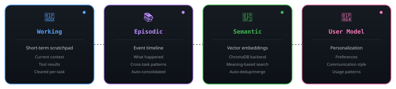
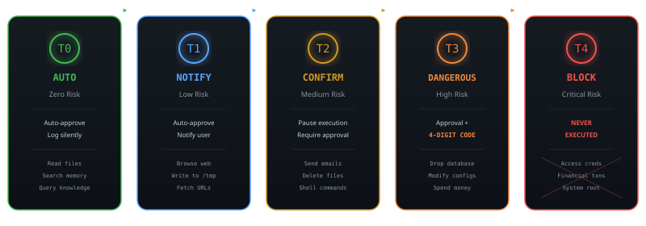

<div align="center">

<picture>
  <source media="(prefers-reduced-motion: reduce)" srcset="assets/readme/motion/atlas-titlecard-static.svg">
  
</picture>

<br/>

[](pyproject.toml)
[](src/atlas/interfaces/api)
[](frontend)
[](frontend)
[](frontend)
[](src/atlas/infra)
[](src/atlas/knowledge)
[](src/atlas/tools)
[](LICENSE)

**[Overview](#overview)** · **[Architecture](#architecture-and-execution-model)** · **[Core Subsystems](#subsystems--specifications)** · **[Technology Stack](#technology-stack)** · **[Local Development](#local-development)** · **[Quality Gates](#quality-gates-and-verification)** · **[Security Boundaries](#operational-considerations-and-security-boundaries)**

</div>


## Overview

**ATLAS (Autonomous Task & Learning Agent System)** is a local-first, personal agent runtime engineered in Python and coupled with a Next.js 16 operator dashboard. It integrates bounded task orchestration, multi-provider model routing, five-tier cognitive memory, reciprocal-rank document retrieval, and sandboxed developer workspace tooling into a unified, safety-governed runtime.

The system explores deterministic execution controls for agentic reasoning loops—combining strict risk tier classification, interactive human approval queues, forward-linked cryptographic audit records, and continuous quality verification across CLI, REST, and WebSocket transports.


## Architecture and Execution Model

Every interaction—whether dispatched from the command line, REST API, WebSocket streams, or automated cron schedules—travels through a centralized execution funnel:

<div align="center">
<picture>
  <source media="(prefers-reduced-motion: reduce)" srcset="assets/readme/motion/atlas-pipeline-static.svg">
  
</picture>
</div>

### Request Lifecycle

```text
  [ Ingress Transport ] ───▶ [ InboundEvent Normalization ]
                                          │
                                          ▼
                               [ OTAR Orchestration Loop ] ◀───┐
                                (Observe ➔ Think ➔ Act ➔ Reflect)│
                                          │                      │
                                          ▼                      │
                               [ Tool Request Extraction ]       │
                                          │                      │
                                          ▼                      │
                               [ Safety Risk Classifier ]        │ (Next Step)
                                (T0 ➔ T1 ➔ T2 ➔ T3 ➔ T4)         │
                                          │                      │
                   ┌──────────────────────┴──────────────────────┐
                   │                                             │
             [ Approved ]                                   [ Denied ]
                   │                                             │
                   ▼                                             ▼
       [ Sandboxed Execution ]                        [ Rejection Event ]
        Docker / Host Runner                                     │
                   │                                             │
                   └──────────────────────┬──────────────────────┘
                                          │
                                          ▼
                              [ SHA-256 Audit Record ]
                               (Append to Hash Chain)
                                          │
                                          └──────────────────────┘
```

1. **Ingress Normalization**: All incoming transports construct a structured, immutable `InboundEvent` with source provenance. Transports cannot bypass execution controls.
2. **OTAR Reasoning Loop**: The runtime executes an Observe-Think-Act-Reflect cycle. Context is synthesized from active working memory, episodic history, and retrieved knowledge before invoking model inference.
3. **Deterministic Safety Classification**: Proposed tool calls pass through a fail-closed risk classifier matching arguments against configured policies. Unknown actions default to human approval.
4. **Approval & Gate Enforcement**:
   - **Tier 0 (Auto)**: Read-only operations execute immediately.
   - **Tier 1 (Notify)**: Low-risk mutations execute with operator notification.
   - **Tier 2 (Confirm)**: State-modifying actions pause in the Approval Queue until approved via the CLI or Dashboard.
   - **Tier 3 (Confirm Code)**: Destructive actions require input of a generated verification code.
   - **Tier 4 (Deny)**: Blocked command patterns and prohibited paths are rejected immediately.
   - **Kill Switch**: Re-verified immediately before tool execution to honor asynchronous cancellation.
5. **Sandboxed Execution**: Tools run within a resource-limited Docker container (`python:3.13-slim`) or via the host-level native executor for local development.
6. **Cryptographic Audit Chain**: Execution inputs, outputs, timestamps, and hashes are written into an append-only SQLite audit log forward-linked by SHA-256 hash chains.


## Subsystems & Specifications

### 1. Task Orchestration & Reasoning Loop

<div align="center">

</div>

- **Observe**: Collects current environment state, working memory notes, tool results, and retrieved research documents.
- **Think**: Constructs bounded model prompts, selects appropriate tools from the registry, and formulates step arguments.
- **Act**: Dispatches validated tool requests through the safety classifier and sandboxed executors.
- **Reflect**: Analyzes execution outcomes, updates task progress, logs error reflections, and decides termination or follow-up actions.
- **Loop Bounds**: Default 25-step execution ceiling, 120-second step timeout, and 1800-second cumulative task timeout.
- **Task Leases**: Distributed execution leases tracked in SQLite (`runtime_execution_leases`) prevent zombie tasks and recover after unexpected process restarts.

---

### 2. Five-Tier Cognitive Memory

<div align="center">

</div>

| Memory Tier | Storage Backend | Function & Retention Policy |
| --- | --- | --- |
| **Working** | In-Memory / Context Scratchpad | Active task context, temporary tool observations, token-budgeted truncation per turn |
| **Episodic** | SQLite (`episodic_memories`) | Event timeline, historical task resolutions, success/failure retrospectives |
| **Semantic** | ChromaDB (`bge-m3:latest`) | Entity relation graphs, extracted concepts, domain facts, dense vector embeddings |
| **User Model**| SQLite (`user_profile`) | User preferences, system permissions, operator interaction habits |
| **Trajectories** | SQLite (`task_trajectories`) | Complete step-by-step reasoning traces, model tokens, and action payloads |

#### Two-Lane Hybrid Recall

<div align="center">
<picture>
  <source media="(prefers-reduced-motion: reduce)" srcset="assets/readme/motion/atlas-recall-lanes-static.svg">
  
</picture>
</div>

- **Lane 1 (SQL Direct Search)**: Fast indexed SQL lookup over write-time trigger hints. Ranked by importance weighted by exponential time-decay ($importance \times 2^{-\frac{age}{30d}}$). Zero embedding overhead.
- **Lane 2 (Dense & Lexical Fusion)**: Escalation path triggered when Lane 1 yields insufficient relevance and recall intent is detected. Combines ChromaDB vector similarity (`bge-m3:latest`) and BM25 lexical keyword scoring via Reciprocal Rank Fusion ($k=60$).

---

### 3. Safety Architecture & Risk Tiers

<div align="center">

</div>

- **Fail-Closed Policy Matching**: Every tool operation and argument payload is evaluated against deterministic regexes and path allowlists defined in `config/permissions.yaml`.
- **Interactive Approval Queue**: Pending Tier 2 and Tier 3 operations are suspended in SQLite and surfaced in real time to the CLI and Web Dashboard.
- **Cryptographic Audit Log**: Each audit entry links to the prior entry's hash:
  $$\text{hash}_n = \text{SHA-256}(\text{hash}_{n-1} \mathbin{\Vert} \text{timestamp} \mathbin{\Vert} \text{action} \mathbin{\Vert} \text{payload})$$
  Ensures chronological continuity across all executed actions.

---

### 4. Developer Workspaces & Sandboxing

- **Docker Tool Sandbox**: Isolated container execution (`python:3.13-slim`) with constrained CPU (default: 1.0), memory (default: 512 MB), read-only root filesystems, and bounded volume mounts.
- **Native Host Executor**: Direct execution on the host system intended strictly for local development and debugging (does not establish an isolation boundary).
- **Workspace Engineering Tools**:
  - File tree exploration and syntax validation.
  - Patch generation and editing with Myers Shortest Edit Script (SES) diff previews.
  - Safe Git staging, status inspection, and branch management.
- **Model Context Protocol (MCP)**: Full client implementation supporting external tool servers over `stdio` and `sse` transports with automated tool discovery and schema generation.


## Technology Stack

### Backend Infrastructure

| Component | Technology | Version / Spec | Role in ATLAS |
| --- | --- | --- | --- |
| **Language** | Python | `3.13+` | Asynchronous core runtime |
| **Package Management** | `uv` | Modern lockfile | Deterministic dependency tree (`uv.lock`) |
| **Web Framework** | FastAPI | `0.115+` | High-throughput REST & WebSocket endpoints |
| **ASGI Server** | Uvicorn | `0.34+` | Async loop server with graceful lifespan handling |
| **Data Contracts** | Pydantic v2 | `2.10+` | Schema validation and serialization |
| **Config Engine** | Pydantic Settings | `2.7+` | Layered YAML + `.env` environment loading |
| **Database** | SQLite + `aiosqlite` | SQLite 3 | Embedded store with 36 schema migrations |
| **Cloud Persistence** | PostgreSQL + `asyncpg` | Relational | Optional adapter for distributed session persistence |
| **Vector Store** | ChromaDB | `0.6+` | Semantic vector storage and nearest-neighbor search |
| **Embeddings** | Ollama (`bge-m3:latest`)| 1024-dim | Local dense multilingual text embeddings |
| **Lexical Search** | `rank-bm25` | BM25Okapi | Inverted index keyword retrieval |
| **Tool Protocols** | MCP Python SDK | `1.2+` | Model Context Protocol client (`stdio`, `sse`) |
| **Browser Driver** | Playwright | `1.49+` | Headless Chromium web automation |

### Frontend Dashboard

| Component | Technology | Version / Spec | Role in ATLAS |
| --- | --- | --- | --- |
| **Framework** | Next.js | `16.2.11` | React Server Components & App Router |
| **UI Library** | React | `19.2.4` | Component architecture |
| **Language** | TypeScript | `5.7+` | End-to-end type safety |
| **Styling** | Tailwind CSS | `4.0+` | Modern CSS tokens, dark mode, responsive layouts |
| **State & Fetching** | TanStack Query | `v5.66+` | Server-state caching and WebSocket subscription |
| **Client Validation**| Zod | `3.24+` | Client-side runtime schema validation |
| **Iconography** | Lucide React | Modern set | High-fidelity interface icons |

### Quality & Automation Tooling

| Category | Tools | Configuration |
| --- | --- | --- |
| **Linting & Style** | Ruff | `ruff.toml` / `pyproject.toml` |
| **Type Checking** | Mypy | `mypy.ini` (strict mode across core packages) |
| **Layer Boundaries** | Import-Linter | `importlinter.ini` (14 architectural layers, 3 contracts) |
| **Unit & Integration** | Pytest | `tests/unit`, `tests/integration`, `pytest-asyncio` |
| **Frontend Tests** | Vitest + Playwright | `frontend/vitest.config.ts`, `frontend/e2e/` |
| **Benchmarking** | Eval Gate | `scripts/eval_gate.py` with recorded answers |
| **CI / CD** | GitHub Actions | `.github/workflows/ci.yml` |


## Local Development

### System Requirements

- **Python**: 3.13 or newer with `uv`.
- **Node.js**: 22 LTS with `npm`.
- **Ollama**: Local inference service running `qwen3:4b` and `bge-m3:latest`.
- **Docker**: (Optional) For containerized tool isolation.

### 1. Installation

```bash
git clone https://github.com/aman-bhaskar-codes/ATLAS.git
cd ATLAS

# Synchronize virtual environment with locked dependencies
uv sync --frozen
```

### 2. Environment Configuration

Create a `.env` file at the repository root:

```dotenv
ATLAS_ENV=dev
ATLAS_DATA_DIR=./.atlas
ATLAS_PROFILE=local_free
ATLAS_OLLAMA_HOST=http://127.0.0.1:11434
ATLAS_LOCAL_MODEL=qwen3:4b
ATLAS_DEFAULT_MODEL=local-qwen3
ATLAS_EMBED_PROVIDER=ollama
ATLAS_EMBED_MODEL=bge-m3:latest
ATLAS_LOCAL_EMBED_MODEL=bge-m3:latest
ATLAS_API_KEYS=
ATLAS_MASTER_KEY=
```

Generate an instance master key for credential encryption:

```bash
uv run python -c "import secrets; print(secrets.token_hex(32))"
```

Save the generated hex key in `ATLAS_MASTER_KEY`. Pull the required local models:

```bash
ollama pull qwen3:4b
ollama pull bge-m3:latest
```

### 3. Launching the Backend API

Start Uvicorn via the application factory on `127.0.0.1:8730`:

```bash
uv run uvicorn atlas.interfaces.api.app:create_app --factory --host 127.0.0.1 --port 8730
```

Verify runtime health in another terminal:

```bash
uv run python -m atlas.interfaces.cli doctor
```

Interactive OpenAPI documentation is served at `http://127.0.0.1:8730/api/docs`.

### 4. Launching the Next.js Dashboard

```bash
cd frontend
npm ci
npm run dev
```

Open `http://localhost:3030` to access the dashboard.


## Quality Gates and Verification

The repository enforces eight distinct verification gates across linting, static analysis, architectural boundaries, tests, and evaluation benchmarks:

```bash
# Gate 1: Code formatting and linting
uv run ruff check .

# Gate 2: Static type verification
uv run mypy

# Gate 3: Architectural layering contracts
uv run lint-imports --config importlinter.ini

# Gate 4: Backend unit & integration test suite
uv run pytest

# Gate 5: Frontend linting (from frontend/)
npm run lint

# Gate 6: Frontend unit and component tests (from frontend/)
npm run test:unit

# Gate 7: Production dashboard build (from frontend/)
npm run build

# Gate 8: Recorded benchmark evaluation gate
uv run python scripts/eval_gate.py --answers eval/recorded/answers.json
```

Continuous integration runs all gates on pull requests and pushes to `main`. See [.github/workflows/ci.yml](.github/workflows/ci.yml).


## Operational Considerations and Security Boundaries

1. **Host Execution vs. Docker Sandboxing**: The development native executor executes commands directly on the host machine and does not establish a security isolation boundary. For untrusted code, configure and enable the Docker tool sandbox.
2. **Path Scope Boundaries**: Filesystem allowlists in `config/permissions.yaml` establish expected operational paths. For strict isolation, run ATLAS within an isolated container or dedicated unprivileged user account.
3. **Audit Log Concurrency**: The SQLite audit log relies on serialized transaction commits to guarantee chronological SHA-256 hash continuity.
4. **Network Exposure**: By default, the API binds to loopback (`127.0.0.1`). If exposing the API beyond localhost, configure `ATLAS_API_KEYS` and place the service behind a TLS reverse proxy.
5. **Experimental Modules**: Subsystems in `src/atlas/adaptation/` and `src/atlas/training/` represent experimental research pipelines. See [IDE training documentation](docs/ide/training.md) for compute requirements and evaluation boundaries.


## Technical Documentation Index

- [Architecture Overview](ARCHITECTURE.md)
- [Runtime Startup Sequence](docs/runtime/STARTUP_SEQUENCE.md)
- [Runtime Readiness Model](docs/runtime/READINESS_MODEL.md)
- [Tool Catalog & Schema](docs/tooling/catalog.md)
- [Routing Architecture](docs/routing/architecture.md)
- [Execution Engine Architecture](docs/execution/architecture.md)
- [MCP Integration & Configuration](docs/tooling/mcp/configuration.md)
- [Local Documents & OCR](docs/knowledge/local-ocr.md)

---

## License

This project is licensed under the [MIT License](LICENSE). Copyright 2026 Aman Bhaskar.
